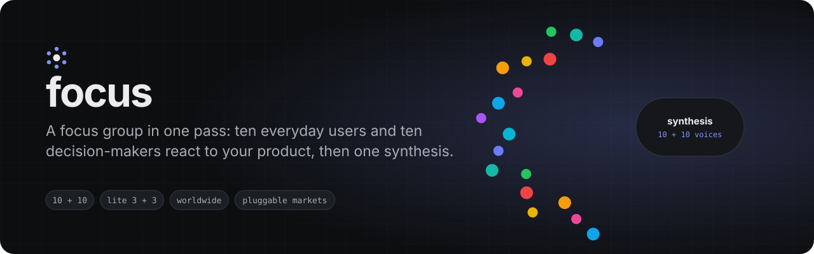
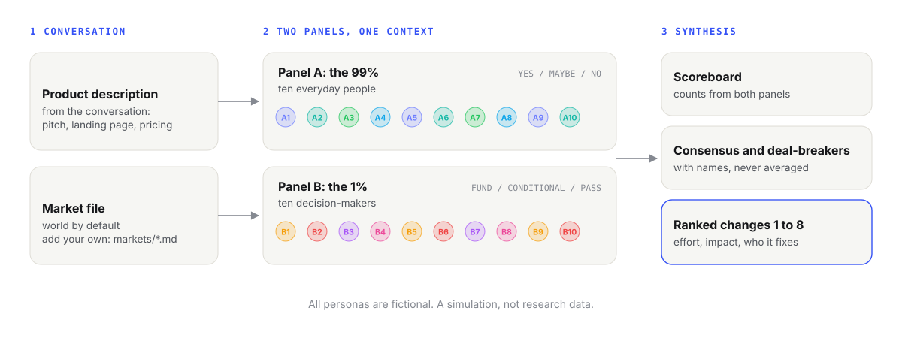

<p align="center">
  
</p>

<p align="center">
  <a href="LICENSE"></a>
  <a href="https://github.com/GameOwerMedia/focus/actions/workflows/ci.yml"></a>
  
  
</p>

**focus** is a Claude Code skill that runs a simulated focus group on the product
in your conversation: ten everyday people and ten decision-makers each react in
their own voice, then one synthesis counts the verdicts, names who agrees, ranks
the changes that would move the most people and says where the money and the
market disagree.

It is fast (one response), cheap (one context) and honest about what it is: a
structured way to hear twenty different objections before real people raise
them, not a substitute for talking to customers.

> Looking for a Polish-market version? See **[focusPL](https://github.com/GameOwerMedia/focusPL)**.
> Want each persona to be a separate agent that actually opens your live product?
> See **[focus-swarm](https://github.com/GameOwerMedia/focus-swarm)**.

## Demo

The [example conversation](examples/larder/conversation.md) pitches *Larder*, a
fictional shared-pantry app with a card-required trial, US and UK receipt
scanning and a plan to fund discounts with shopping data. Typing `/focus`
produced the excerpt below. `[...]` marks every cut; the text between cuts is
copied from the [full output](examples/larder/output-full.md). Both example
outputs are verbatim except for one persona in each, renamed after the run (the
note at the top of each file says exactly what changed).

```markdown
Market: world (USD pricing, US and UK receipts, global app stores, no single-country tie). Size: 10 + 10. [...]

*All personas are fictional. Their reactions are a simulation, not research data.*

[...]
### A2. Tunde Adeyemi, 27, QA tester at a fintech, London (grew up in Lagos)
[...]
**First 10 seconds:** "Up to five members. We are six. So who gets voted off the fridge? Then I scanned plantain chips from the African shop on the high street and it had no idea what they were. The big supermarket receipt worked first time though, fair play."
[...]
### B1. Hannah Lindqvist, 44, General Partner, a seed fund that backs consumer subscription apps
[...]
**Their question:** "Of the 400 beta households, how many still add or remove an item every week, and how many people in each house are doing it?"
[...]
**Verdict:** CONDITIONAL. I take the pre-seed meeting if the beta cohorts show sustained weekly upkeep by more than one person per household, the trial converts to monthly or asks first, and partner offers are out of the deck as a revenue line.
[...]
## Synthesis

### 1. Scoreboard

- **Panel A:** 2 YES (A1 Megan, A5 Gerald), 4 MAYBE (A2 Tunde, A8 Wanjiru, A9 Marta, A10 Omar), 4 NO (A3 Priya, A4 Lucía, A6 Seo-yeon, A7 Brandon).
- **Panel B:** 1 FUND (B3 Claire, a paid pilot, not equity), 6 CONDITIONAL (B1 Hannah, B2 Daniel, B6 Sofia, B7 Lars, B8 Aisha, B9 Tomás), 3 PASS (B4 Ravi, B5 Gemma, B10 Ingrid).

The concept lands; the business wrapped around it does not. [...]
[...]
### 4. High-impact changes, ranked 1 to 8

1. **Make the trial honest: no card for the trial, or a card that converts to monthly with a reminder before the charge, and offer annual at the end as a choice.**
   Fixes it for: A1 Megan (no surprise $47.88 to explain), A7 Brandon (stops the "gym membership" read), A8 Wanjiru (can start without a card), B1 Hannah (real conversion data), B4 Ravi (passes store scrutiny), B6 Sofia (removes the biggest legal exposure), B8 Aisha (simpler paywall).
   **Effort:** low. **Impact:** high.
[...]
### 8. Blind spots

1. **The list's accuracy is the product, and nothing in the pitch measures it.** [...]
```

The `lite` run on the same conversation is in
[output-lite.md](examples/larder/output-lite.md) (3 + 3, about 2,000 words).

## Why

Most "ask the AI what users think" prompts return one polite reviewer with
twenty names. This skill is built against that failure:

- **Two rooms, not one.** The people who would use the product and the people
  who decide whether it gets money, distribution or a contract judge it in
  different currencies. The synthesis reports where they disagree instead of
  averaging them.
- **Casting rules, not vibes.** Panel A spans age, income, tech literacy,
  geography and relationship to the product, and must include a category
  skeptic and an outsider. Panel B has fixed seats (money, gatekeepers,
  operators, strategists, a domain expert) and at least three skeptical or
  hostile members.
- **Counts and names.** Every claim in the synthesis says who made it. The
  ranked change list says which personas each change would win over, so you can
  see whether a fix helps the people who were already friendly or the ones who
  walked out.
- **No invented facts.** No made-up statistics, market sizes, grant amounts or
  quotes. Real public institutions, funds and outlets are named as market
  context (the market file lists them) and may appear as a persona's employer;
  the people themselves are always fictional.

## Install

**As a plugin** (Claude Code 2.x):

```text
/plugin marketplace add GameOwerMedia/focus
/plugin install focus@focus
```

Installed as a plugin, the skill is namespaced by the plugin name: run it as
`/focus:focus` (and `/focus:focus lite`).

**Manually:** copy `skills/focus` into `~/.claude/skills/` (all projects) or
`.claude/skills/` inside one project. Installed this way it is plain `/focus`
(and `/focus lite`). The examples below use the short form. With either install
you can also just ask in plain words ("run a focus group on this").

```bash
git clone https://github.com/GameOwerMedia/focus
cp -r focus/skills/focus ~/.claude/skills/
```

No scripts, no dependencies, no network access. The skill is a prompt plus a
market file.

## Quick start

Describe your product in the conversation (paste the pitch, the landing page
copy, the pricing), then:

```text
/focus            10 + 10 personas, full synthesis, worldwide market
/focus lite       3 + 3 personas, top 5 changes only
/focus lite us    use references/markets/us.md if you have added one
```

You can also just ask: "run a focus group on this", "what would investors and
normal users say about this pricing page?".

## How it works

<picture>
  <source media="(prefers-color-scheme: dark)" srcset="assets/how-it-works-dark.svg">
  
</picture>

1. **Read the room.** The skill infers product, audience, model, stage, price
   and geography from the conversation, states its assumptions in one line,
   and only asks when the product itself is unclear.
2. **Load a market.** `references/markets/world.md` sets where people live,
   what they pay with, which kinds of funders, gatekeepers and regulators sit
   on Panel B, and which competitors count as the benchmark.
3. **Two panels.** Ten Panel A reviews (first 10 seconds, works, doesn't work,
   wish, YES / MAYBE / NO) and ten Panel B reviews (30-second scan, concerns,
   what they need to see, FUND / CONDITIONAL / PASS with conditions).
4. **Synthesis.** Scoreboard, consensus, deal-breakers, eight ranked changes,
   money versus market, fault lines, the wildcard insight, a power move, blind
   spots and a market note.

## Configuration

| Argument | Default | Effect |
|---|---|---|
| *(none)* | | 10 + 10 personas, full nine-part synthesis |
| `lite` | off | 3 + 3 personas, short reviews, scoreboard plus top 5 changes |
| `<market>` | `world` | loads `references/markets/<market>.md` |

### Adding a market

Copy [`references/markets/TEMPLATE.md`](skills/focus/references/markets/TEMPLATE.md)
to `references/markets/<code>.md` (for example `de.md`, `us.md`, `jp.md`) and
fill its seven sections: **Detect**, **Language and style**, **Panel A**,
**Panel B**, **Rules and regulators**, **Benchmarks**, **Labels**. A market file
can switch the output language, the currency, the verdict labels and the pool
of institutions, media and platforms Panel B is drawn from. Run it with
`/focus <code>`. The test suite checks that every market file has all seven
sections. [focusPL](https://github.com/GameOwerMedia/focusPL) is a complete
example of how far a single-market adaptation can go.

## FAQ

**Is this user research?** No. It is a simulation that is good at surfacing
objections, conflicts and blind spots quickly. Treat every finding as a
hypothesis to check with real people.

**Why are the personas fictional even when they work at a real fund?** Putting
invented words in a real person's mouth is misleading, so the skill never does
it. Panel B may describe a real type of organisation ("a corporate venture arm
of a packaged-food company"); the person is always invented.

**Does it browse my product?** No. It works from what the conversation says.
For agents that actually open a URL, a repository or a document, use
[focus-swarm](https://github.com/GameOwerMedia/focus-swarm).

**How long is the output?** About 7,000 words for 10 + 10 and about 2,000 for
`lite` on the example.

**Which model should I use?** The strongest one you have. Voice separation and
an honest synthesis are what degrade first on smaller models.

## Limitations

- One context voices all twenty people, so some convergence is unavoidable;
  the casting rules and the "no comfort" rule reduce it but do not remove it.
  focus-swarm removes it by giving every persona its own agent.
- Panel B knowledge of real institutions is only as current as the model.
  The skill is told not to invent amounts or deadlines; check anything you plan
  to act on.
- Output quality depends on the product description. A one-line pitch gets
  generic reactions.

## Roadmap

- More market files from contributors (`us`, `de`, `jp`, `br`, `in`).
- An optional emphasis argument to give one panel more depth.
- Evals with fixed example conversations for regression checks.

## Repository layout

```text
skills/focus/SKILL.md                     the skill
skills/focus/references/markets/world.md  default market
skills/focus/references/markets/TEMPLATE.md
examples/larder/                          example conversation and real outputs
tests/                                    structure checks (python -m unittest)
assets/                                   banner and diagrams
```

## License

[MIT](LICENSE). Contributions welcome, see [CONTRIBUTING.md](CONTRIBUTING.md).
